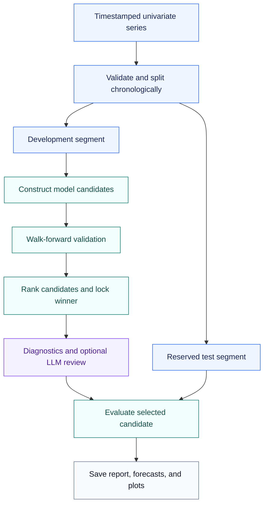

<div align="center">

# Automated Hybrid ARIMA–ML Pipeline

### Time-series forecasting with LLM-assisted diagnostic review

**Statistical modelling · Machine learning · Chronological evaluation**


A modular Python framework for comparing standalone and hybrid forecasting models,
selecting configurations through chronological validation, and reviewing the
statistical evidence with an optional large language model.

[Overview](#overview) · [Methodology](#methodology) · [Quick start](#quick-start) · [LLM review](#optional-llm-review) · [Outputs](#experiment-outputs)

</div>

---

## Overview

Does modelling the errors of one forecasting method with another improve predictions? Does the order of those methods matter?

This project makes those questions testable within a common evaluation protocol. It compares **ARIMA**, **XGBoost**, and two additive residual hybrids: **ARIMA → XGBoost** and **XGBoost → ARIMA**. Zero, persistence, and Ridge forecasts provide reference models.

The pipeline automates data validation, feature construction, candidate evaluation, model selection, diagnostics, and experiment reporting. An optional LLM interprets development-stage evidence and Q–Q plots. The final model is selected by measured validation error.

| Component | Implemented approach |
| :--- | :--- |
| Forecasting task | Univariate, one-observation-ahead point prediction |
| Statistical model | ARIMA with configurable order and trend |
| Machine learning model | XGBoost with lag and rolling-statistic features |
| Hybrid construction | Additive correction of chronological first-stage forecast errors |
| Model search | Bounded grids over complete candidate pipelines |
| Validation | Walk-forward evaluation with an explicit window and refit policy |
| Final assessment | Reserved chronological test segment for the selected candidate |
| Interpretation | Statistical diagnostics and optional structured LLM review |
| Reporting | JSON report, CSV rankings and forecasts, optional Q–Q plots |

## Architecture



The LLM receives development evidence before final test evaluation. Its review is attached to the experiment without modifying the locked winner.

## Methodology

### 1. Forecasting objective

For an observed series $y_1,\ldots,y_T$, the task is to predict the next observation using the information available at the forecast origin:

$$
\widehat{y}_{t\mid t-1}=f_{\theta}(\mathcal{H}_{t-1}),
\qquad \mathcal{H}_{t-1}=\{y_1,\ldots,y_{t-1}\}.
$$

Parameter estimation uses the permitted training history. Between scheduled refits, newly observed values update forecasting context while the fitted parameters remain fixed.

A forecast step means the **next observation**. With irregular timestamps, it does not imply a constant elapsed duration.

### 2. Standalone and reference models

| Candidate | Forecasting mechanism |
| :--- | :--- |
| ARIMA | Autoregressive and moving-average dynamics, with configurable differencing and trend |
| XGBoost | Gradient-boosted regression trees using features computed from past observations |
| Zero | Constant zero forecast; useful as a reference for returns and forecast errors |
| Persistence | Most recently observed value |
| Ridge | Standardized linear regression on lagged observations |

The default XGBoost features use lags **1, 2, 3, 6, 12, 24** and rolling means and standard deviations over **6, 12, 24** observations. The default Ridge reference uses lag features only. Feature windows are configurable through `FeatureConfig`.

### 3. Additive residual hybrids

Let $\widehat{b}_{t\mid t-1}$ denote the first-stage forecast. Its chronological error is

$$
e_t=y_t-\widehat{b}_{t\mid t-1}.
$$

A second model learns to predict this error from earlier first-stage errors. The combined forecast is

$$
\widehat{y}_{t\mid t-1}
=\widehat{b}_{t\mid t-1}
+w\,\widehat{e}_{t\mid t-1},
\qquad 0\leq w\leq 1.
$$

`HybridConfig.correction_weight` sets $w$ explicitly; its default is **1.0**.

| Architecture | First stage | Correction stage |
| :--- | :--- | :--- |
| `arima_to_xgboost` | ARIMA forecasts the target | XGBoost forecasts ARIMA errors |
| `xgboost_to_arima` | XGBoost forecasts the target | ARIMA forecasts XGBoost errors |

Correction targets are generated through an **inner chronological forecasting pass** within the supplied training history. Each first-stage prediction precedes its target. After generating these targets, the first stage is refitted on the supplied training window.

As new observations arrive, the hybrid extends the error history of the original first-stage model. This preserves the correction model's target definition.

### 4. Chronological evaluation and selection

1. **Reserve the final test segment.** By default, the last 20% of observations are held out.
2. **Evaluate candidates on development data.** All candidates use the same forecast targets, window policy, and outer refit schedule.
3. **Rank by validation error.** Select the lowest RMSE, or MAE when configured. The other error metric provides the secondary sort key.
4. **Lock the selected configuration.** Diagnostics, descriptive near ties, and LLM commentary leave this choice unchanged.
5. **Evaluate the selected candidate on the test segment.** At each origin, predict first, then reveal the next observation. Earlier revealed test values may update context and scheduled fits.
6. **Record the experiment.** Save settings, selection evidence, forecasts, diagnostics, timings, and package versions.

Failed candidates remain visible in the ranking. A run with failed forecast dates is invalidated rather than compared on a smaller, easier subset of observations.

The test evaluation inherits the development window, metric, and refit policy. Its refit schedule restarts at the first test origin. With refitting disabled, the selected model is fitted on development data once and subsequently updates only its forecasting context.

### 5. Metrics and diagnostics

The primary selection metrics are

$$
\mathrm{RMSE}=\sqrt{\frac{1}{N}\sum_{t=1}^{N}(y_t-\widehat{y}_t)^2},
\qquad
\mathrm{MAE}=\frac{1}{N}\sum_{t=1}^{N}|y_t-\widehat{y}_t|.
$$

Additional scores include mean error, MASE, RMSSE, and optional directional accuracy. MASE and RMSSE use first differences of a preceding training reference; undefined scales are reported as unavailable.

| Diagnostic | Purpose |
| :--- | :--- |
| ADF and KPSS | Complementary assessments of target stationarity |
| Ljung–Box | Check serial correlation in forecast errors |
| ARCH-LM | Check conditional variance dependence |
| Jarque–Bera | Assess departures in skewness and kurtosis from normal moments |
| Normal Q–Q plots | Inspect distributional shape and tail deviations visually |
| ACF/PACF utility | Examine dependence at observation lags when called explicitly |

Diagnostic p-values are exploratory and unadjusted for multiple testing. Non-rejection does not establish that a null hypothesis is true. Residual normality does not determine the hybrid order, and the implemented near-tie tolerance is descriptive rather than a statistical equivalence test.

## Quick start

### Set up the environment

Use a dedicated environment; **Python 3.11 or newer** is recommended for the declared scikit-learn dependency.

```bash
git clone https://github.com/Alikhabazian0/Automated-Hybrid-Arima-Ml-Llm-Assisted-Pipeline.git arima-ml-pipeline
cd arima-ml-pipeline
python -m venv .venv
```

Activate it on macOS/Linux:

```bash
source .venv/bin/activate
```

On Windows PowerShell:

```powershell
.\.venv\Scripts\Activate.ps1
```

Install the core scientific packages:

```bash
python -m pip install --upgrade pip
python -m pip install numpy pandas scipy "scikit-learn>=1.8,<2" "statsmodels>=0.15,<0.16" "xgboost>=3.1,<4" matplotlib
```

> **Dependency note:** The current `requirements.txt` contains an invalid `python == 3.10.0 +` entry. Python is installed separately. The commands above install the imported packages directly; record and test resolved versions before using an environment as a reproducibility reference. SciPy is used directly by the diagnostics module. Matplotlib is optional when plots and image review are both disabled.

### Run the synthetic demonstration

```bash
python pipeline.py --demo --output results/demo_01
```

The demonstration generates a seeded synthetic series with autoregressive, nonlinear, periodic, and stochastic components. It requires no external dataset or API key. Default fixed mode compares four model architectures and three reference models.

Use a **new output directory** for each experiment; existing results are protected from overwrite.

### Run your own time series

Provide a CSV with a timestamp column and a numeric target column. For example:

```csv
date,target
2024-01-01 00:00:00,0.0012
2024-01-01 01:00:00,-0.0004
2024-01-01 02:00:00,0.0008
```

These rows illustrate the schema; a real experiment needs enough observations for training, hybrid error generation, validation, and testing.

```bash
python pipeline.py \
  --csv data.csv \
  --time-column date \
  --target-column target \
  --mode fixed \
  --output results/custom_01
```

CSV loading sorts by timestamp. Duplicate timestamps, missing targets, and non-finite values are rejected. Missing observations and irregular spacing are not filled automatically. Use `--utc` when timestamps should be normalized to UTC; naive timestamps are then interpreted as UTC.

### Search a bounded model grid

```bash
python pipeline.py \
  --demo \
  --mode search \
  --p-max 1 \
  --q-max 1 \
  --d-values 0 \
  --max-candidates 256 \
  --output results/search_01
```

Search mode enumerates valid ARIMA order/trend configurations and evaluates complete standalone and hybrid candidates. Add `--tune-ml` to search the eight-setting XGBoost grid. The candidate budget applies to the combined grid; exceeding it raises an error before model fitting.

## Configuration

| CLI option | Default | Meaning |
| :--- | :--- | :--- |
| `--mode` | `fixed` | Compare fixed configurations or search a bounded grid |
| `--order P D Q` | `1 0 1` | ARIMA order in fixed mode |
| `--test-fraction` | `0.2` | Fraction reserved at the end of the series |
| `--initial-train-size` | `200` | Initial outer training history, in observations |
| `--refit-every` | `0` | `0`: fit once per evaluation segment; positive values: refit every specified number of observations |
| `--window-size` | Unset | Unset: expanding history; integer: trailing history window |
| `--metric` | `rmse` | Selection metric: `rmse` or `mae` |
| `--direction-mode` | Unset | Optional directional scoring: `returns` or `levels` |
| `--pipelines` | All four | Requested model architectures; reference models remain included |
| `--max-candidates` | `256` | Maximum number of complete candidate configurations |
| `--llm-model` | Unset | Optional compatible OpenAI model ID |
| `--no-qq-review` | Off | Omit Q–Q images from LLM review |
| `--no-plots` | Off | Disable saved plots |

All lag, window, and refit counts refer to observations. The initial training window must satisfy the history requirements of every requested candidate, including both stages of a hybrid. Outer refitting and the hybrid's inner error-generation refitting are separate settings; configure the latter through `HybridConfig` in Python.

For directional scoring, `returns` compares the signs of actual and predicted targets. `levels` compares their changes relative to the last observed value. The metrics also report prediction coverage and accuracy conditional on a nonzero predicted direction. Directional scores are fractions in $[0,1]$.

Run `python pipeline.py --help` for the full command reference. Multiline shell examples above use Bash continuation syntax; in PowerShell, put each command on one line or use PowerShell continuation syntax.

## Python API

The API exposes feature definitions, refit policies, hybrid settings, and candidate grids through configuration objects.

```python
from features import FeatureConfig
from hybrids import HybridConfig
from metrics import MetricConfig
from pipeline import PipelineConfig, run_csv_pipeline
from validation import ValidationConfig

config = PipelineConfig(
    mode="fixed",
    features=FeatureConfig(
        lags=(1, 2, 3, 6, 12, 24),
        rolling_windows=(6, 12, 24),
    ),
    hybrid=HybridConfig(
        initial_train_size=100,
        base_refit_every=24,
        correction_weight=1.0,
    ),
    validation=ValidationConfig(
        initial_train_size=200,
        refit_every=24,
        metrics=MetricConfig(direction_mode="returns"),
    ),
)

experiment = run_csv_pipeline(
    "data.csv",
    time_column="date",
    target_column="target",
    config=config,
    output_dir="results/api_01",
)

print(experiment.summary())
print(experiment.selection.leaderboard)
```

Set `direction_mode="returns"` only when the target represents returns or another quantity whose sign has the intended directional meaning. Use `"levels"` for direction relative to the last observed level, or leave it unset.

## Optional LLM review

The LLM is an **advisory reviewer of forecasting evidence**. Model fitting, validation, and numerical ranking run independently of it.

| Review input | Review output |
| :--- | :--- |
| Development candidate scores and configuration evidence | Structured verdict and explanation |
| Target and forecast-error diagnostics | Concerns and suggested follow-up checks |
| Optional normal Q–Q plots | Comments on distributional shape and tails |

The review has a validated output schema. API errors, refusals, and invalid responses are recorded while preserving the selected candidate. Schema validation checks structure and candidate references; it does not establish the factual accuracy of natural-language claims.

Install the optional SDK and configure your credentials outside the source code:

```bash
python -m pip install openai
export OPENAI_API_KEY="YOUR_API_KEY"
```

Then provide a model available to your account that supports the Responses API and structured outputs, plus image input when Q–Q images are enabled:

```bash
python pipeline.py \
  --demo \
  --llm-model YOUR_COMPATIBLE_MODEL_ID \
  --output results/llm_review_01
```

Omitting `--llm-model` runs the forecasting experiment without an API key. A custom provider can be integrated through a callable accepting `ReviewRequest` and returning the prescribed review dictionary.

## Experiment outputs

| File | Contents |
| :--- | :--- |
| `experiment.json` | Configuration, selected model, metrics, diagnostics, LLM status, data fingerprints, timings, and installed package versions |
| `validation_ranking.csv` | Candidate configurations, status, validation error ranking, and failure details |
| `validation_forecasts.csv` | Chronological predictions from successful development runs |
| `test_forecasts.csv` | Reserved-test predictions from the selected candidate |
| `validation_qq.png` | Selected candidate's development forecast-error Q–Q plot |
| `test_qq.png` | Selected candidate's test forecast-error Q–Q plot |

Forecast files are conditional on successful runs. Plots are conditional on plotting being enabled, usable error samples, and plotting dependencies being available. The JSON report records plot status.

Inspect the summary of a completed demonstration:

```python
import json
from pathlib import Path

report = json.loads(Path("results/demo_01/experiment.json").read_text())
print(json.dumps(report["summary"], indent=2))
```

The repository provides an experiment framework. Performance claims should be based on saved runs with identified datasets and declared evaluation settings; the synthetic demonstration alone does not establish financial predictability.

## Reference synthetic run

The following results were obtained with the documented `--demo` command in fixed mode. The generated series contains **600 observations**, with **480 development observations**, an initial outer training history of **200**, **280 validation forecasts**, and **120 reserved-test forecasts**. The generator uses seed **42** and outer refitting is disabled.

| Candidate | Validation RMSE ↓ | Validation MAE ↓ |
| :--- | ---: | ---: |
| **ARIMA** | **0.127662** | **0.101789** |
| Persistence | 0.128510 | 0.102474 |
| Ridge | 0.129556 | 0.102077 |
| XGBoost | 0.140126 | 0.111285 |
| ARIMA → XGBoost | 0.143818 | 0.113011 |
| XGBoost → ARIMA | 0.146265 | 0.115296 |
| Zero | 0.370013 | 0.322127 |

The selected ARIMA configuration achieved reserved-test **RMSE 0.134356** and **MAE 0.109731**. Only the development winner was evaluated on that segment. Residual correction did not improve validation error in this run; broader conclusions require additional datasets, seeds, and uncertainty assessment.

<details>
<summary>Reference environment</summary>

| Package | Version |
| :--- | :--- |
| Python | 3.12.14 |
| NumPy | 2.3.5 |
| pandas | 2.2.3 |
| SciPy | 1.17.0 |
| scikit-learn | 1.8.0 |
| statsmodels | 0.15.0 |
| XGBoost CPU distribution | 3.4.1 |
| Matplotlib | 3.10.8 |

The reference run used the CPU-only `xgboost-cpu` distribution, which exposes the same `xgboost` import. Installing `xgboost` follows the standard setup above. Resolved dependencies and numerical libraries can affect reproduced values.

</details>

## Repository map

| Module | Responsibility |
| :--- | :--- |
| [`data.py`](data.py) | CSV loading, series validation, chronological holdout |
| [`features.py`](features.py) | Past-only lag and rolling features |
| [`models.py`](models.py) | Shared forecasting interface and reference models |
| [`arima_model.py`](arima_model.py) | ARIMA configuration, fitting, and forecasting |
| [`xgboost_model.py`](xgboost_model.py) | XGBoost configuration, fitting, and forecasting |
| [`hybrids.py`](hybrids.py) | Chronological error generation and residual correction |
| [`metrics.py`](metrics.py) | Error, scaled-error, and directional metrics |
| [`validation.py`](validation.py) | Walk-forward forecasting and model comparison |
| [`search.py`](search.py) | Candidate grids, budgets, and validation ranking |
| [`diagnostics.py`](diagnostics.py) | Statistical tests, correlation utilities, and Q–Q plots |
| [`selection.py`](selection.py) | Winner locking, diagnostic evidence, structured LLM review |
| [`pipeline.py`](pipeline.py) | Experiment orchestration, command-line interface, reporting |

## Scope and interpretation

The implemented task is univariate one-step point forecasting with non-seasonal ARIMA and XGBoost. Multivariate/exogenous inputs, seasonal ARIMA, recursive multi-step forecasts, prediction intervals, and trading execution are possible extensions.

Hybrid construction is an empirical hypothesis: a correction stage can improve or worsen forecasts, and either standalone method or a reference model may win. The reserved test evaluates the selected configuration; repeated manual tuning against that same test would compromise its role as a holdout.

For financial applications, forecast error and directional accuracy should be supplemented by a separately specified trading evaluation with costs and execution assumptions before drawing conclusions about economic value.

For reproducible comparisons, retain the generated report and forecasts alongside the dataset definition, source revision, and resolved environment. Use the same target dates and evaluation policy when comparing alternative configurations.

---

<div align="center">

**ARIMA + XGBoost · Chronological validation · Optional LLM interpretation**

Developed by [Alikhabazian0](https://github.com/Alikhabazian0)

</div>
